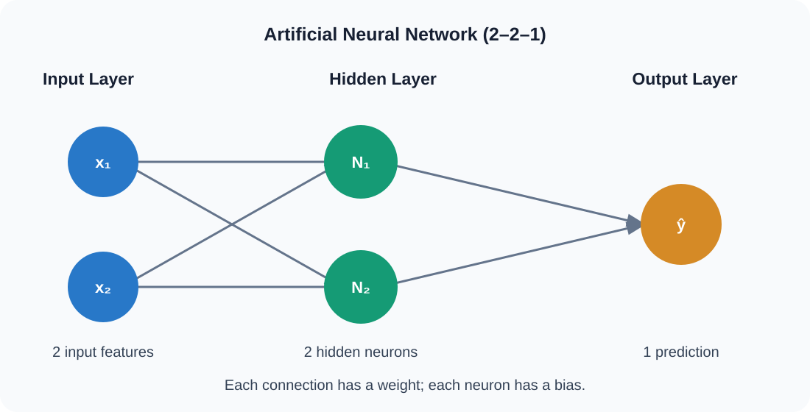

# Artificial Neural Network (ANN) – Training Steps

A beginner-friendly guide to the **12 steps of Artificial Neural Network (ANN) training**, with simple explanations and mathematical examples.

## Network Architecture

This example uses a small **2–2–1 neural network**:

- 2 input features
- 2 hidden neurons
- 1 output neuron



## Example Problem

Suppose we want to predict whether a student passes or fails.

| Variable | Meaning | Value |
|---|---|---:|
| `x1` | First input feature (scaled) | 1 |
| `x2` | Second input feature (scaled) | 0 |
| `y` | Actual target | 1 |

For this mathematical example, `1` represents Class 1 (Pass) and `0` represents Class 0 (Fail). The input values are illustrative, not real student measurements.

We use:
- **Activation function:** Sigmoid
- **Loss function:** Squared Error
- **Optimizer:** Gradient Descent
- **Learning rate:** 0.1

---

## 1. Input Data

**Description:** Input data is the information given to the neural network. The network uses this information to make a prediction.

$$
X=[x_1,x_2]=[1,0]
$$

The network receives two input values: `1` and `0`.

## 2. Weight and Bias Initialization

**Description:** Weights control how strongly inputs affect a neuron. Bias helps the neuron adjust its output. At the beginning, the network is assigned initial weight and bias values.

| Parameter | Initial value |
|---|---:|
| `w1` | 0.5 |
| `w2` | 0.4 |
| `w3` | 0.3 |
| `w4` | 0.2 |
| `v1` | 0.6 |
| `v2` | 0.5 |
| `b1`, `b2`, `bo` | 0.1 each |

Here, `w1` and `w2` connect the inputs to hidden neuron 1; `w3` and `w4` connect the inputs to hidden neuron 2. `v1` and `v2` connect the hidden neurons to the output neuron.

## 3. Weighted Sum Calculation

**Description:** Each neuron multiplies every input by its weight, adds the results, and then adds its bias.

General formula:

$$
z=\sum_i x_iw_i+b
$$

For hidden neuron 1:

$$
z_1=(1\times0.5)+(0\times0.4)+0.1=0.6
$$

For hidden neuron 2:

$$
z_2=(1\times0.3)+(0\times0.2)+0.1=0.4
$$

## 4. Activation Function

**Description:** The activation function transforms a neuron's weighted sum into an output value. It helps a neural network learn non-linear patterns.

We use the Sigmoid function:

$$
\sigma(z)=\frac{1}{1+e^{-z}}
$$

For hidden neuron 1:

$$
a_1=\sigma(0.6)\approx0.6457
$$

For hidden neuron 2:

$$
a_2=\sigma(0.4)\approx0.5987
$$

The hidden layer outputs are now `a1 = 0.6457` and `a2 = 0.5987`.

## 5. Forward Propagation

**Description:** Forward propagation is the process of moving information from the input layer through the hidden layer to the output layer to generate a prediction.

The output neuron receives `a1` and `a2`:

$$
z_o=(a_1v_1)+(a_2v_2)+b_o
$$

$$
z_o=(0.6457\times0.6)+(0.5987\times0.5)+0.1
$$

$$
z_o\approx0.7868
$$

Apply Sigmoid:

$$
\hat y=\sigma(0.7868)\approx0.687
$$

The network's prediction is approximately **0.687**.

> Note: Weighted-sum calculation and activation are operations inside forward propagation. They are shown separately here to make the learning process easier to follow.

## 6. Loss Calculation

**Description:** Loss measures the difference between the actual answer and the network's prediction. A smaller loss generally means a better prediction.

Actual output: $y=1$

Predicted output: $\hat y\approx0.687$

We use squared error for this single example:

$$
L=\frac{1}{2}(y-\hat y)^2
$$

$$
L=\frac{1}{2}(1-0.687)^2
$$

$$
L\approx0.0489
$$

## 7. Backpropagation

**Description:** Backpropagation sends the prediction error backward through the network. It calculates how each weight and bias contributes to the loss.

For a sigmoid output neuron:

$$
\delta_o=(\hat y-y)\hat y(1-\hat y)
$$

Using the more precise prediction value, $\hat y\approx0.6871$:

$$
\delta_o\approx-0.0673
$$

For hidden neuron 1:

$$
\delta_1=\delta_o\,v_1\,a_1(1-a_1)
$$

$$
\delta_1\approx-0.0092
$$

For hidden neuron 2:

$$
\delta_2=\delta_o\,v_2\,a_2(1-a_2)
$$

$$
\delta_2\approx-0.0081
$$

These error terms are used to calculate gradients.

## 8. Gradient Calculation

**Description:** A gradient tells us how the loss changes when a weight or bias changes. It helps the optimizer decide how to update each parameter.

For output weight `v1`:

$$
\frac{\partial L}{\partial v_1}=\delta_o a_1
$$

$$
\frac{\partial L}{\partial v_1}\approx-0.0434
$$

For output weight `v2`:

$$
\frac{\partial L}{\partial v_2}=\delta_o a_2
$$

$$
\frac{\partial L}{\partial v_2}\approx-0.0403
$$

For hidden-layer weights:

$$
\frac{\partial L}{\partial w_1}=\delta_1x_1\approx-0.0092
$$

$$
\frac{\partial L}{\partial w_2}=\delta_1x_2=0
$$

$$
\frac{\partial L}{\partial w_3}=\delta_2x_1\approx-0.0081
$$

$$
\frac{\partial L}{\partial w_4}=\delta_2x_2=0
$$

The gradients for the biases are:

$$
\frac{\partial L}{\partial b_1}=\delta_1,\quad
\frac{\partial L}{\partial b_2}=\delta_2,\quad
\frac{\partial L}{\partial b_o}=\delta_o
$$

Because `x2 = 0`, the gradients of `w2` and `w4` are zero in this example.

## 9. Weight and Bias Update

**Description:** The optimizer updates weights and biases using their gradients. The goal is to reduce the loss.

We use Gradient Descent:

$$
w_{\text{new}}=w_{\text{old}}-\eta\frac{\partial L}{\partial w}
$$

Learning rate:

$$
\eta=0.1
$$

For output weight `v1`:

$$
v_{1,\text{new}}=0.6-0.1(-0.0434)
$$

$$
v_{1,\text{new}}\approx0.6043
$$

For output bias:

$$
b_{o,\text{new}}=0.1-0.1(-0.0673)
$$

$$
b_{o,\text{new}}\approx0.1067
$$

The same update rule is applied to all weights and biases.

## 10. Iteration / Epoch

**Description:** Training repeats the forward pass, loss calculation, backpropagation, gradient calculation, and parameter update.

- **Iteration:** One parameter-update step.
- **Epoch:** One complete pass through the entire training dataset.

After one update in this example, the prediction is approximately `0.6898`, and the loss is approximately `0.0481`. The loss has decreased slightly from about `0.0489`.

## 11. Model Evaluation

**Description:** Model evaluation checks how well the trained network performs on separate data that was not used to train it.

For classification, common evaluation metrics include:
- Accuracy
- Precision
- Recall
- F1-score

Example: if the model correctly predicts 8 out of 10 test samples:

$$
Accuracy=\frac{8}{10}\times100=80\%
$$

The model's test accuracy is **80%**.

## 12. Prediction (Inference)

**Description:** Inference means using the trained network to predict the output for new input data. No weight update is performed during normal inference.

For a new input:

$$
X_{\text{new}}=[0,1]
$$

Using the updated parameters, the network produces a prediction of approximately:

$$
\hat y\approx0.684
$$

Using a threshold of 0.5:

- If $\hat y\geq0.5$, predict Class 1.
- If $\hat y<0.5$, predict Class 0.

Since `0.684 >= 0.5`, the predicted class is **Class 1**.

---

## Summary of the 12 Steps

| No. | Step | Purpose |
|---:|---|---|
| 1 | Input Data | Receive input information |
| 2 | Weight and Bias Initialization | Set initial parameters |
| 3 | Weighted Sum Calculation | Multiply inputs by weights and add bias |
| 4 | Activation Function | Convert weighted sum into neuron output |
| 5 | Forward Propagation | Generate a prediction |
| 6 | Loss Calculation | Measure prediction error |
| 7 | Backpropagation | Send error backward through the network |
| 8 | Gradient Calculation | Calculate parameter gradients |
| 9 | Weight and Bias Update | Update model parameters |
| 10 | Iteration / Epoch | Repeat the learning process |
| 11 | Model Evaluation | Check performance on unseen data |
| 12 | Prediction (Inference) | Predict new data |

## Complete Training Flow

```text
Input Data
    ↓
Initialize Weights and Biases
    ↓
Weighted Sum
    ↓
Activation Function
    ↓
Forward Propagation
    ↓
Prediction
    ↓
Loss Calculation
    ↓
Backpropagation
    ↓
Gradient Calculation
    ↓
Weight and Bias Update
    ↓
Repeat Training (Iterations / Epochs)
    ↓
Model Evaluation
    ↓
Prediction on New Data (Inference)
```

## Key Notes

- **Weights** control the influence of inputs.
- **Bias** adjusts a neuron's output.
- **Activation function** adds non-linearity.
- **Loss** measures prediction error.
- **Backpropagation** calculates how parameters contribute to error.
- **Optimizer** updates weights and biases using gradients.
- **Epochs** allow the network to learn through repeated training.

---

### Author

**Md. Arafat Hossain**

Beginner-friendly learning notes on Artificial Neural Networks and Deep Learning.
